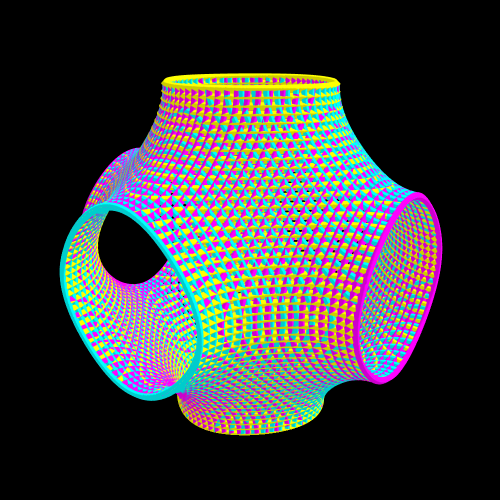

## Motivation

The motivation for this Jupyter notebook came from additive manufacturing of TPMS structures and the desire to emerge from 2.5d printing to full 3d printing paths.

The possibility to print paths in the 3-dimensional space is highly dependand on your printer. I use a 2PP printer (see Two-Photon Lithography on Wikipedia) that allows free 3d path inside my build volume.

## Structure

xxxx

## Parameters to set

Change to `True` or `False` whether you want a gcode and/or plot output.

````
gcode_output = False
plot_output = True
````

=== "Schwarz P"

    This is the Schwarz P surface.

=== "Diamond"

    This is the Diamond surface.

=== "Gyroid"

    This is the Gyroid surface.


You can take a [Pause](generalinformation.md) before you continue reading.

The Gyroid surface can be described by:

\[
\sin(x)\cos(y) + \sin(y)\cos(z) + \sin(z)\cos(x) = 0
\]

The first examples of TPMS were the surfaces described by Schwarz in 1865, followed by a surface described by his student E. R. Neovius in 1883.



*Example of a schwarzP TPMS.*